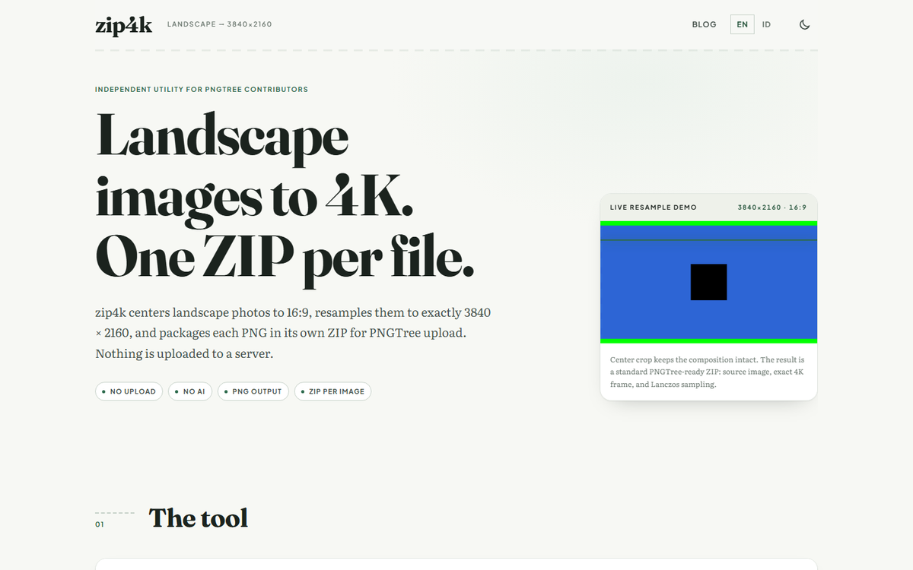
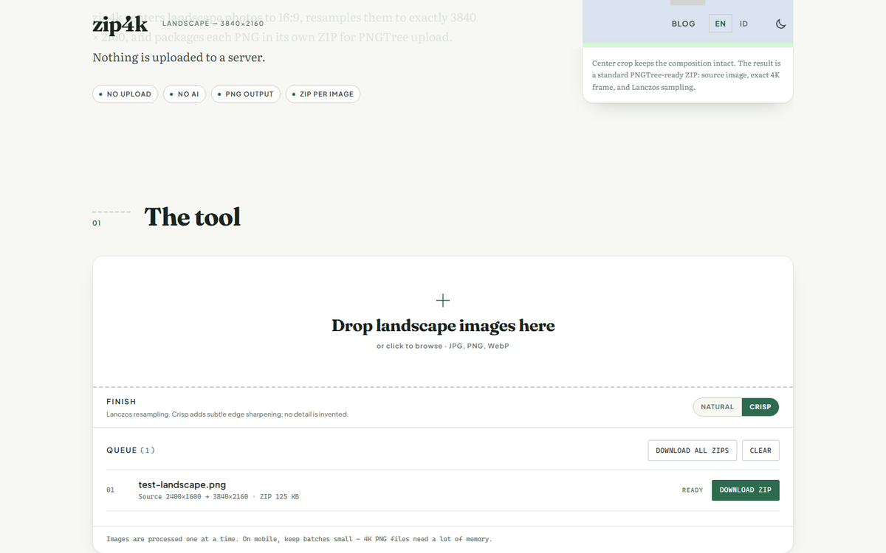
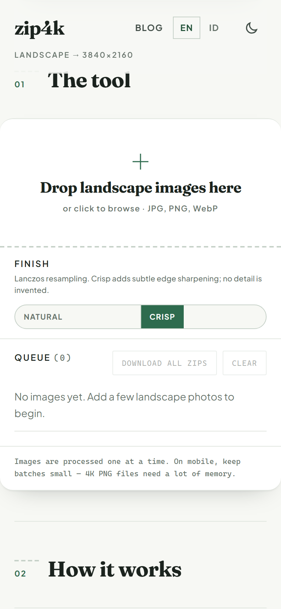

# zip4k

[](https://zip4k.pages.dev/)
[](./LICENSE)
[](https://astro.build/)

An independent batch utility for PNGTree contributors. It center-crops landscape images to 16:9, resizes them to exactly 3840 × 2160, exports PNG, and packages each image in its own ZIP for upload to PNGTree. zip4k is not an official PNGTree tool and is not affiliated with PNGTree.

[Live demo](https://zip4k.pages.dev/) · [Blog](https://zip4k.pages.dev/blog/) · [How to use zip4k](https://zip4k.pages.dev/blog/how-to-use-zip4k/)







Everything runs in the browser. Images are never uploaded, and there is no AI in the pipeline — it uses WebGL2 Lanczos resampling and optional light sharpening, with Canvas 2D as a fallback.

## Quick start

1. Add landscape photos by dropping them onto the drop zone (or click to browse: JPG, PNG, WebP).
2. Choose a **Finish**: **Natural** (Lanczos only) or **Crisp** (Lanczos + light unsharp mask, default).
3. Wait for the green **READY** status, then download one ZIP per image — or use **DOWNLOAD ALL ZIPS**.

Each ZIP contains exactly one PNG at **3840 × 2160** in **16:9** after a centered crop. Processing is sequential (one image at a time) to keep memory predictable, especially on mobile.

## Features

- Center-crop any landscape image to 16:9
- Resize to exactly 3840 × 2160 px with Lanczos resampling
- Optional light sharpening (Natural or Crisp), still no AI
- PNG output, one file per ZIP
- Drag and drop, multi-file queue
- Bilingual: English (`/`) and Indonesian (`/id/`)
- Blog scaffold for both languages (`/blog/`, `/id/blog/`), first post: [How to use zip4k](https://zip4k.pages.dev/blog/how-to-use-zip4k/)
- Static Astro site, deployable to Cloudflare Pages

## Development

```bash
npm install
npm run dev
```

```bash
npm run check     # astro check (types + Astro diagnostics)
npm run build     # production build to dist/
npm run preview   # preview the production build
```

Requires Node.js 22.23.4 or newer (Node 24 recommended); `.nvmrc` pins Node 22 for local use and CI.

## Project layout

- `src/pages/` — routes: home pages, blog listings, blog posts
- `src/components/` — Masthead, Footer, Tool, HomePage
- `src/layouts/BaseLayout.astro` — document shell, SEO, hreflang, JSON-LD
- `src/data/` — English/Indonesian copy and site constants
- `src/scripts/` — client-side queue, image pipeline, UI strings
- `src/styles/global.css` — sage/forest theme matching the owner's Ngalam + IkanGuppy identity (Fraunces, Literata, Plus Jakarta Sans), light/dark mode
- `src/content/blog/{en,id}/` — Markdown posts
- `public/` — favicon, OG image, robots.txt, Cloudflare `_headers`

## Blog

Add a Markdown file to `src/content/blog/en/` and its Indonesian counterpart to `src/content/blog/id/` with the same slug:

```md
---
title: Preparing landscape images for stock platforms
description: A short summary used for listings and SEO.
lang: en
pubDate: 2026-01-15
updatedDate: 2026-01-20
draft: false
---

Your content here.
```

Both language versions are optional. While a language has no published posts, its listing page is marked `noindex`.

## Deploy to Cloudflare Pages

Connect this repository in the Cloudflare dashboard and use:

| Setting | Value |
| --- | --- |
| Framework preset | Astro |
| Build command | `npm run build` |
| Output directory | `dist` |
| Environment variable | `NODE_VERSION` = `22` (if the build image defaults to an older Node) |

## Domain

The production URL is defined in two places:

- `astro.config.mjs` — `site` (canonical URLs and sitemap)
- `src/data/site.ts` — `SITE_URL` (canonical, hreflang, Open Graph, JSON-LD)

If you attach a custom domain, update both. The sitemap is generated by `@astrojs/sitemap` as `sitemap-index.xml`, and `public/robots.txt` points to it.

## How processing works

1. The image is decoded with `createImageBitmap` (falling back to an `` decode).
2. The largest 16:9 rectangle is centered and cropped.
3. A separable Lanczos filter in WebGL2 resamples it to exactly 3840 × 2160.
4. The Crisp finish applies a light 5×5 unsharp mask; Natural skips it. Neither invents detail.
5. The canvas is encoded to PNG and stored uncompressed in a ZIP archive (`fflate`).

If WebGL2 is unavailable, too large a source is used, or the GPU path fails, the tool falls back to a high-quality Canvas 2D resize without sharpening. Processing is sequential to keep memory use predictable, especially on mobile.

## Privacy

No image leaves your device. There is no server upload, no account, and no tracking of the pixels you process. The tool does use Google Fonts and, when imported, the Google Fonts stylesheet is fetched from Google. Otherwise the pipeline is fully client-side.

## Stack

- [Astro](https://astro.build/) 7 + TypeScript
- WebGL2 for Lanczos resampling and sharpening; Canvas 2D fallback
- [fflate](https://github.com/101arrowz/fflate) for ZIP packaging
- No UI framework, no runtime dependencies besides fflate

## License

MIT — see [LICENSE](./LICENSE).
